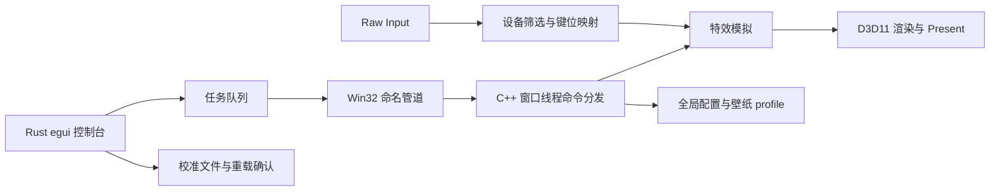

# 架构基线 · 2026-11-17

## 证据范围

Observed：部署包 BUILD-SOURCES.json 指向 Rust 管理器与 validation/native/windows-player。
本工作区复制了当次检查的源码；source-manifest.json 用 SHA-256 记录文件来源。
未将部署清单的二进制哈希视为已完成源码到二进制的一致性证明。
当前尚无历史提交，无法可靠计算变更热点。
source-manifest.json 记录复制时的基线哈希；后续有意修改通过 Git diff 审查，不要求继续与旧源逐字一致。

## 当前运行链路

## 已观察到的职责与耦合

| 范围 | 证据 | 观察与风险 |
| --- | --- | --- |
| IPC | apps/manager/src/lib.rs: command、worker；native/windows-player/src/main.cpp: dispatch、run | root 参数与固定管道连接身份未建立关系；管道请求同步进入窗口线程。多实例语义待实测，不能直接判定为缺陷。 |
| 壁纸激活 | native/windows-player/src/main.cpp: selectPack、trigger、applyAppearance、render、hasMotion | 多种特效知识分散；已有候选资源准备及背景回滚，拆分时必须保留。 |
| 配置 | native/windows-player/src/PackSettings.cpp: prepare、commit；apps/manager/src/lib.rs: Calibration | 全局配置、壁纸 revision 与校准 ACK 有不同事务语义；不应合并成无差别 save 操作。 |
| 生命周期 | native/windows-player/src/main.cpp: Player::run | 初始化、输入、IPC、窗口消息、GPU 等待和清理存在时序耦合，应最后处理。 |
| 构建与交付 | 原 build.ps1、部署 BUILD-SOURCES.json | 工具链与源码路径绑定本机；先形成可迁移工作区，随后接通资源及原生构建。 |

静态耦合来自特效类型与入口相互依赖；动态耦合来自 IPC 到窗口线程的同步分发；数据耦合来自共享文件与确认协议；时间耦合来自 GPU、暂停及退出顺序；部署耦合来自管理器、播放器与资源目录。组织所有权尚未定义。

## 候选排序

1. 播放器控制 module（Strong）：集中连接身份、请求与响应语义；保护超时、64 KiB 上限和旧 ACK 隔离。
2. 壁纸激活 module（Strong）：集中准备、验证、切换与释放；保护失败保留旧壁纸和像素一致性。
3. 配置事务 module（Strong，第二批）：明确各文件拥有者；保护 revision 和外部并发写入。
4. Windows 会话 module（Worth exploring）：集中初始化与清理；风险为死锁、忙等和输入饥饿，最后推进。

这是候选范围与优先级，尚未确定新的具体 interface。

## 回归基线

本轮在原源码目录重新运行：Rust release/locked 测试 34 + 58 = 92 项通过；7 项原生核心 CTest 通过。
原生检查使用现有 Release 测试二进制，未重新编译，尚不能证明其与当前源码完全一致。
未运行实屏展示、管理员交接、GPU 压测或长时间稳定性测试。

已有水彩报告的 CPU submit P95 7.785 ms、GPU P95 1.960 ms 为 reported 数据，不是本轮复测，也不能直接定位为物理模拟瓶颈。

## 未解决事项

- 新目录下的原生构建、资源加载和依赖获取。
- 所有素材的来源与分发许可；主项目许可证。
- 多运行目录与固定管道的产品语义。
- 配置兼容、安装布局、版本升级策略。
- 新 interface 设计及行为保持的实现验证。

## 第一项迁移改动

管理器的 schema 控件测试原先读取仓库外的 palette-adaptation 实验目录。
现已将 7 份 schema 固定为 tests/fixtures/background-schemas 测试夹具并改用仓库内路径。
新的 tools/build-manager.ps1 使用调用者的 Cargo 环境，不再写死 D 盘工具链目录。

用户选定 IPC 优先后，已将端点、默认超时和响应解释集中到 player_control，并保留现有调用路径。
新工作区最终重新构建：Rust 37 + 58 = 95 项测试通过，release 管理器构建成功。
现有命名管道传输测试继续通过；多实例隔离与实机连接未在本轮新增验证。
