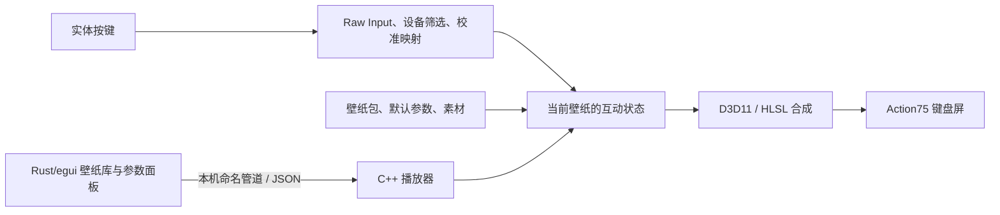

# ACTION75 壁纸制作 Agent 指南

从空目录制作可以独立导入的壁纸时，使用[壁纸作者技能](../../skills/action75-wallpaper-author/SKILL.md)。技能包含公开包格式、参数声明、离屏试播与按键画面回读脚本。

先做一款能在壁纸库选中、在 Action75 键盘屏上按键触发的作品。首次制作可以跟着[「琥珀余波」练习](implementation.md#first-pack)走一遍。替换背景、按键动画和配色就能练习完整接入，遇到全屏水面、吸积盘或复杂烟花时再扩展原生渲染。

## 从哪个版本开始

在 `DeepSeek/Action75-OpenSource` 工作区内，以当前源码、`wallpapers-native` 和 `tools` 为准。这里的控制台使用 Rust/egui，键盘屏由 C++17/D3D11 播放器绘制。目标是 Windows 扩展模式下的 Action75，基准画幅为 **1920×720（8∶3）**，播放帧率上限为 **60 FPS**。

先读仓库 README 和产品约定，再打开与本次任务最接近的一款壁纸的 `manifest.json`、`settings.json` 和对应渲染器。`action75-wallpaper` 是早期 Electron 版，`Action75-v2-Trial` 是历史试用部署。旁边的研究目录、`dist` 和 `release` 留有实验或构建产物。交付前用当前源码构建或核实使用的二进制来源，尤其是同一工作区有其他会话正在修改时。 [仓库 README](../../README.md) · [产品约定](../product-decisions.md)

## Agent 工作顺序

1. **把想法写成可以验收的场景。** 写清待机画面、按下一次会发生什么、松开或连按怎么处理、动效怎么结束、要开放哪些参数。把「点击水面」落实成实体键在校准中心激起波纹。用户指定鼠标拖拽或交互时，另外检查副屏窗口和独占模式。
2. **选能复用的实现。** 改背景、图集、已实现的配色或参数，做独立壁纸包。需要自定义物理、全屏折射、角色或游戏输入时，使用[原生插件接口](../../skills/action75-wallpaper-author/references/native.md)。可直接参考[独立键盘小游戏](../../examples/native-wallpapers/key-game/README.md)。[实现路线与文件地图](implementation.md)
   参数可以用 JSON 模板组合并展开为独立的 `settings.json`。已有 14 款壁纸的对照配方可选。[参数模板与校验](templates/README.md)
3. **按键盘屏构图。** 在 8∶3 画面里先做待机、起势、峰值和收尾。用真实参考提取材质、形状与运动，用离屏样片检查亮度和节奏。把反复出现的特效自然变化设计进实现，尤其是同键连按和多键叠加。[视觉制作与历史案例](visual-design.md)
4. **接入完整路径。** 为新作品取独立 ID，把资源、预览和参数放入包目录。用隔离实例验证壁纸可发现、可选择、按键有反应、参数有效且可保存。涉及新代码时，检查普通播放器、性能目标和壁纸库能否识别它。[实现路线](implementation.md) · [预览与验收](verification.md)
5. **交付实渲染证据。** 给出包路径、如何选择、实际画面与短视频或连续帧、验证结果与尚待实机确认的项目。用户只要求开发和试看时，交付工作区版本即可。用户要求安装包时，再走仓库打包流程。[预览与验收](verification.md#release)

### 开始前记住三件事

- 按键中心来自共享校准。实机校准有 83 个可映射点。Fn 可以出现在拟合键帽的示意图里，独立触发取决于硬件是否向 Windows 上报可映射事件。屏幕黑边和键帽轮廓可能天然错开，保留真实相对位置。
- 新作品有自己的资源和参数。前景特效与背景分别调节，常用区只放效果明显且常用的选项，其余进入高级。壁纸库缩略图取自播放器实渲染。
- 用隔离运行根目录和管道试作，保留日常壁纸、校准和参数。并行工作时先确认其他会话正在改哪些公共文件，合并时逐处核对当前版本。

如果需求里有「每次力度随机」「可设上下限」或「背景可切换」，直接跟着「水波」看壁纸包怎么定义控件、播放器怎么归整有效区间、场景怎么在每次触发时取样。 [随机范围和背景样板](implementation.md#impact-and-background)

## 发给 Agent 的起步提示

> 请在 `Action75-OpenSource` 的最新源码上制作一款【主题】壁纸。先读 `docs/wallpaper-authoring/README.md` 和它链接的实现与验收文档，再读最接近的现有壁纸和对应后端。目标是 Action75 的 1920×720 键盘屏，输出 60 FPS。待机时【背景、材质和运动】。按下实体键时，在对应位置【如何起势、变化和收尾】。快速连按和多键同时触发时【如何叠加】。常用参数需要【列出确实有用的几项】。参考【图片、影片或作品】的视觉规律。先在隔离环境出实渲染样片，完成壁纸库接入、参数验证和性能记录。交付壁纸 ID、实际画面、验证结果和实机确认情况。

如果暂时描述不清，就给 Agent 一张参考图、一句话说明按下去发生什么，以及你最在意的一个观感。其余可先用可逆的默认值做出样片，再对照修改。
