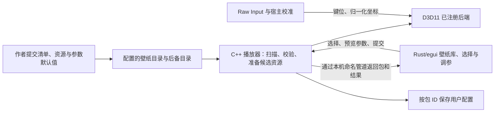

# Action75 Wallpaper 第三方壁纸导入可行性

2026-11-18 · 工作区源码与本地 0.3.1 发布产物

## 结论

| 想给用户的承诺 | 判定 | 能交付到哪一步 |
| --- | --- | --- |
| **复用已有后端**。作者交付一个文件夹，用户预览、播放、按键和调参 | **现在可用，导入体验需要一次性完善** | 已支持按文件夹发现新 ID。把包复制到壁纸目录并刷新，可用原有二进制切换和保存参数。正式的单包导入入口、兼容检查和失败说明需要补齐。 |
| **作者自创交互或材质**。作者发新包，播放器无需逐包重编 | **粒子效果已有入口，自定义材质仍需验证，通用交互需要一次性改造** | 发布版能加载兼容的 Effekseer 效果，并绑定已有材质的命名 uniform。两种修改着色内容的试件在切换时超时。新的按键规则、全屏场景和 GPU 模拟需要宿主先提供有限场景图、事件或渲染接口。 |
| **直接搬入其他软件的任意壁纸文件夹** | **按格式适配** | PNG、视频或支持的粒子文件可复用。别家场景、脚本、材质和输入接口依赖各自宿主，兼容性需要按来源和功能逐项实现与验收。 |

首个面向用户的目标可以定为「导入支持 Action75 格式的壁纸文件夹」。以 `spriteBurst` 做完整验收，再开放经过验证的 Effekseer 子集。这样既能让第三方发包，也能把集显预算和错误处理落到明确的范围内。[隔离验证记录](wallpaper-import-evidence/results.json) · [复验脚本](wallpaper-import-evidence/run.py)

## 1. 证据范围与加载链

**实测**使用 `release/payload` 暂存的 0.3.1 播放器和控制台，SHA-256 与本地发布清单一致。验证直接启动二进制副本，配置、校准与命名管道都在隔离实例中使用，控制台截图来自单独的 Windows 桌面。**源码观察**覆盖发布源码归档与当前工作树，两份实现可识别的 `kind` 与 GPU 选项有差异。集显只在当前构建副本上单独实测。第 5–7 节提出正式导入的设计与验收建议。[发布校验清单](../release/SHA256SUMS.txt) · [发布源码归档](../release/ACTION75-source-0.3.1.zip) · [复验脚本](wallpaper-import-evidence/run.py)



| 接入环节 | 已观察的行为 | 源码证据 |
| --- | --- | --- |
| 启动与加载配置 | 控制台先查本机管道 `status`，按运行目录启动原生播放器并等待就绪。原生播放器初始化 D3D11、恢复已选包和输出设置，正常模式注册 Raw Input，之后提供控制管道。 | [控制台启动](../apps/manager/src/lib.rs#L246) · [原生播放器初始化](../native/windows-player/src/main.cpp#L1861) |
| 导入与发现 | 屏幕上的「壁纸目录」设置是整库迁移，会复制、检查冲突、请求重载，再清理可确认的旧文件。单包现有操作是把文件夹复制到库目录，使用界面刷新。播放器扫描配置的目录及 `data/native-wallpapers` 的直接子目录。 | [目录迁移 `migrate`](../apps/manager/src/storage.rs#L225) · [管理器刷新](../apps/manager/src/main.rs#L982) · [扫描 `packs`](../native/windows-player/src/main.cpp#L301) |
| 清单、封面与候选加载 | `manifest.json` 版本须为 1，包 ID 和 `kind` 受校验。直接声明的资源从包根解析相对路径，扫描时按类型检查字段、范围和文件，解码结果在选择时确认。`listPacks` 返回支持情况及 schema 诊断。控制台优先用 `preview`，其后尝试 `background` 或 `preview.png` 作为库封面。断线时的本地扫描有独立类型名单，并要求文件夹名等于 ID。 | [清单解析](../native/windows-player/src/main.cpp#L282) · [目录及诊断返回](../native/windows-player/src/main.cpp#L690) · [管理器本地扫描与封面](../apps/manager/src/lib.rs#L642) |
| 后端与切换 | 发布版可走 `spriteBurst`、`effekseer`、`keycap`、`field`、`proceduralBurst`。`image`、`video` 是背景播放类型。当前源码另有 `blackHole`、`waterSurface`、`fireworks`、`glassShatter`。激活在窗口线程按 `kind` 构造候选、加载资源、校验 uniform，再替换活动场景。可返回的装载错误有背景回滚路径。 | [发布源码归档](../release/ACTION75-source-0.3.1.zip) · [当前后端分派 `selectPack`](../native/windows-player/src/main.cpp#L931) · [背景加载与画布烘焙](../native/windows-player/src/NativeRenderer.cpp#L255) |
| 按键、坐标与输出 | 宿主通过 Windows Raw Input 注册键盘，按设备筛选及去重。键码结合安装自带的 Action75 键位表和用户校准，归一化到显示区。播放时在副屏的输出尺寸上换算成像素，交给当前场景。键帽类的几何来自其 `layout.json`。 | [键位表与校准 `PlayerConfig::load`](../native/windows-player/src/PlayerConfig.cpp#L39) · [Raw Input](../native/windows-player/src/RawKeyboard.cpp#L154) · [场景触发](../native/windows-player/src/main.cpp#L1127) |
| 参数声明与 UI | `settings.json` 的 `groups/controls` 生成滑块、开关、下拉、颜色和配色。本机播放器校验类型、值域、映射与 `binding.target`。现有 schema 上限是 32 KiB、16 组、64 控件。作者可定义控件 ID 和默认值，运行含义来自既有绑定，或 Effekseer 材质已经暴露的 uniform。 | [校验与编译参数](../native/windows-player/src/PackSettings.cpp#L282) · [动态控件](../apps/manager/src/pack_ui.rs) · [材质 uniform](../native/windows-player/src/EffekseerBackend.cpp#L124) |
| 持久化 | `previewPackSettings` 可把临时值应用到当前画面。`setPackSettings` 用 `revision` 防止旧提交覆盖，并写入状态目录的 `wallpaper-settings/<id>.json`。源包内 schema 提供默认值，用户值由宿主管。选择结果另存于 `native-player.json`。 | [命令分发](../native/windows-player/src/main.cpp#L1225) · [profile 读取、提交及替换](../native/windows-player/src/PackSettings.cpp#L455) · [管理器草稿与 ACK](../apps/manager/src/pack_model.rs) |

普通资源包按清单和后端接入，`id` 用于识别和存档。首启默认选 `paintball-native`。当前构建的力度范围联动写在 `stillwater`、`glass-shatter` 的 ID 分支里。`fieldTheme` 和 `proceduralStyle` 选择固定实现。Effekseer 的 `runtimeControls` 依赖已知画笔材质命名和 uniform 位置。通用 `material.uniform` 通过运行效果所引用的材质查找命名参数。全屏水面、吸积盘、烟花及碎裂的 C++ 和 HLSL 由原生构建产生，新增场景行为要进入宿主的后端分派。[首启选择](../apps/manager/src/lib.rs#L540) · [ID 特例与绑定](../native/windows-player/src/PackSettings.cpp#L379) · [Effekseer 材质参数](../native/windows-player/src/EffekseerBackend.cpp#L92) · [原生构建](../native/windows-player/CMakeLists.txt)

## 2. 隔离实测

资源包使用新生成的 `qa-glow-…` ID。发布版以 `tidal-glass` 启动，初次扫描没有测试 ID。把新文件夹复制到程序目录之外的库并刷新后，发布版发现并切换到「青光试验」。离屏诊断通过宿主键位表触发 `KeyF` 和 `Space`，在 1920×720 画布上分别命中 `(611.2, 421.4)`、`(810.4, 667.4)`，两个特效处于活动状态。[目录、命中与重启记录](wallpaper-import-evidence/results.json)

发布控制台截图显示新包封面及其三个作者控件。运行时将光纹强度预览到 `0.55×`，配置文件字节保持原样。提交强度 `0.65×`、底图亮度 `0.75×` 后，过期 `revision` 的写入被拒绝。以同 ID 更新 schema，已有强度沿用，新控件取得默认值。重启恢复选中包及所有值，`Space` 仍能触发。[隔离控制台截图](wallpaper-import-evidence/isolated-library.png) · [实测记录](wallpaper-import-evidence/results.json)

| 对照试件 | 证据和局限 |
| --- | --- |
| `spriteBurst` 原创资源与控件 | 通过发现、切换、离屏触发、参数预览与提交、升级及重启。截图证明封面和参数面板，触发路径有坐标和活动实例数。 |
| 独立作者工具样例 `.efkefc` | 用 Effekseer SDK 的 `square_r.efkefc` 作为独立粒子资源，新 ID 从外部库发现并切换。一次按键后记录到 2 个活跃粒子。作者声明的尺寸参数保存为 `1.35×`，重启恢复选择和值，仍能触发。 |
| `.efk` 和原样 `.efkmat` | 新 ID 的试件从外部库切换到 D3D11/Effekseer。省略 Paintball 专用 `runtimeControls` 后，通用绑定接受 `RuntimePipeline`，作者控件 `authorTint` 保存为 `1.2`。三次诊断触发后记录到 33 个活跃粒子。 |
| 两种修改的 `.efkmat` | 派生试件保留目录依赖。一份只改通用着色代码中的色调，一份同时重命名 uniform。两份在发布版切换时都在 8 秒内未响应，原活动 ID 仍在配置文件中，测试看门狗结束了隔离进程。重命名版在集显构建中也超时。阻塞发生的具体阶段和官方编辑器导出材质的覆盖范围还需验证。 |
| 自定义 HLSL 后端与外部网页目录 | 自定义 `authorRippleGraph` 带着 HLSL 能进入列表，但选择返回不支持。只有 `project.json` 和 HTML 的模拟 Web 目录未出现于列表。由此可界定测试过的发现与分派边界。 |
| 缺资源、不可解码、版本不符、ID 重名 | 缺图集包在扫描时标为不支持。不可解码的 PNG 通过扫描，切换时报 `Decode background image failed (0x88982f50)`。schema 版本错误能显示诊断，清单版本错误会被跳过。配置库优先于后备目录，大小写等价 ID 只展示首个扫描到的条目，同一目录内的枚举顺序未定义。四次返回错误的切换之后，原壁纸仍可触发。 |

离屏验证覆盖宿主输入分派、渲染状态与性能计数。实屏像素、物理键盘到屏延迟和各驱动的长时间稳定性需要另测。修改材质控制试件从发布模板派生，仅由脚本生成到隔离环境。[复验输出](wallpaper-import-evidence/results.json) · [第三方素材权利说明](../README.md)

## 3. 可以交付的最小目录和操作

`spriteBurst` 的最小可验收目录可使用 `author-glow/`。`manifest.json` 声明稳定且唯一的 ID、显示名、后端、图集行列、播放时长、直径和素材相对路径。`background.png` 与 `burst.png` 提供待机图及按键动画，`settings.json` 定义作者开放的参数，`preview.png` 给库里提供专用封面。采用小写 ASCII、数字与连字符且 ID 在 64 字符内，目录名和 ID 一致，以兼顾管理器与播放器两条路径。[可复制示例](wallpaper-import-evidence/author-glow) · [清单](wallpaper-import-evidence/author-glow/manifest.json) · [参数](wallpaper-import-evidence/author-glow/settings.json) · [制作指南](wallpaper-authoring/implementation.md#first-pack)

**作者**选已支持的后端，用宿主认可的清单与绑定，收齐相对引用的资源并提供授权信息。测试同一键、不同键、连按和参数边界。Effekseer 作者需用兼容版本导出效果，随附实际用到的纹理、材质、模型等依赖。Effekseer 官方 `efkpkg` 用于工程间交换。Action75 从清单指向的运行效果文件加载粒子，宿主固定集成 Effekseer 1.80.8 的 D3D11 渲染器和 CPU 粒子运行时。[Effekseer 文件格式](https://effekseer.github.io/Help_Tool/en/ToolReference/index.html) · [运行时构建配置](../native/windows-player/cmake/Effekseer.cmake)

**使用者**在 Action75 Wallpaper 里一次选好输出屏、键盘与校准。现行路径把整包复制到已配置的壁纸库子目录，刷新看封面，选中即切换当前壁纸，之后可以预览参数。正式单包导入可在入库前提供独立的动画预览以及试按键位，确认后启用。播放器依赖 Windows x64、支持 11_0 功能级的 D3D11、`D3DCOMPILER_47.dll`、WIC 以及安装包中的键位表和校准模板。视频还取决于 Media Foundation 和系统解码器。VS、CMake、Rust 和 Inno Setup 属于维护方构建环节。[播放器初始化](../native/windows-player/src/NativeRenderer.cpp#L44) · [依赖集成](../native/windows-player/cmake/Effekseer.cmake) · [安装目标](../tools/setup.iss)

## 4. Wallpaper Engine 提供的参照

| Wallpaper Engine 机制 | 对 Action75 的启发 |
| --- | --- |
| Scene 作者在编辑器组合图层、粒子、时间线、着色器和脚本。Web 作者提供 HTML 与项目资源，编辑器复制工程后建立 `project.json`。Video 复用视频文件，Application 可以交付编译后的程序。 | 可以先定义序列帧、粒子和预制场景各自的契约，再按需求增加运行环境。支持可执行程序涉及单独的权限与进程模型，产品的管理员游戏兼容模式使这条边界更重要。 [类型与编辑器](https://docs.wallpaperengine.io/) · [Web 项目导入](https://docs.wallpaperengine.io/en/web/first/gettingstarted.html) · [作品类型说明](https://help.wallpaperengine.io/en/functionality/editingwallpapers.html) |
| 作者创建的用户属性出现在播放端。Scene 可绑定图层属性，脚本也能读到值及变更。Web 有 `applyUserProperties` 与通用设置事件。 | Action75 已有作者 schema 与宿主控件。下一步是稳定公开参数类型、值域和语义，并提供统一的属性变更、暂停和刷新事件。 [Scene 用户属性](https://docs.wallpaperengine.io/en/scene/userproperties/overview.html) · [Web 属性监听](https://docs.wallpaperengine.io/en/web/api/propertylistener.html) |
| SceneScript 提供初始化、逐帧、窗口尺寸、鼠标与参数变更等事件。共享图层或效果时，编辑工具会携带纹理、着色器和子粒子依赖。 | 应让宿主提供已校准的键位坐标及明确定义的事件，并让作者工具检查依赖是否闭合。一个可以复用的粒子、效果或材质可以供多款作品使用。 [SceneScript 事件](https://docs.wallpaperengine.io/en/scene/scenescript/reference.html) · [组件及依赖分享](https://docs.wallpaperengine.io/en/scene/assets/sharing.html) |
| 同一项目可以重新发布为原创意工坊条目的更新。作者工具内置生成封面，发布表单把作品元数据与素材一起交付。命令行也能在独立窗口运行受支持的作品。 | 支持更新时保留作品 ID 和用户设置。作者导出时可生成封面、依赖列表和最低宿主版本，用户导入时可检查更新差异并在独立画面试播。 [作品发布与更新](https://docs.wallpaperengine.io/en/scene/first/publishing.html) · [独立窗口播放](https://help.wallpaperengine.io/en/functionality/cli.html) |

Action75 可以借鉴它的作者工具，把**可用后端、用户属性和资源依赖**变成作者导出时就能检查的约定。比如「水波」先抽象出 `按键命中坐标 → 产生水滴` 的事件和可调的背景、强度、衰减参数，作者就可以做出不同水面作品。进一步开放事件与粒子、时间线等节点后，作者才能改变「水滴怎样响应同键连按」这类交互。移植 Wallpaper Engine 作品时，要逐个映射场景类型、用户属性、事件和素材依赖。[Wallpaper Engine Scene 编辑器](https://docs.wallpaperengine.io/en/scene/overview.html)

## 5. 正式导入的兼容、隔离与反馈

1. **版本与冲突。** 建议分离 `schemaVersion`、作品版本及最低宿主版本，增加可机读的后端能力需求。当前解析器的 `version: 1` 和文件时间、大小缓存不能充当升级协议。用大小写归一的全局 ID 检查冲突。同 ID 同内容可复用，同 ID 不同内容显示版本和发布者并请求确认。验证到新版本已产出首帧后，再更新活动版本指针。保留旧资源与 profile 供回滚。稳定控件 ID 在有效值域内沿用，重命名与枚举变化应有显式映射。现有资源依赖同路径缓存时也要纳入升级测试。[发现与去重](../native/windows-player/src/main.cpp#L301) · [profile 演进](../native/windows-player/src/PackSettings.cpp#L455) · [效果路径缓存](../native/windows-player/src/EffekseerBackend.cpp#L257)
2. **路径和不受信任内容。** 清单直接资源已有相对路径和规范化检查。还要统一收口包根、封面、动态素材以及 Effekseer 内部依赖。从 staging 复制到宿主控制的只读版本目录，校验实际打开的文件边界，拒绝越界路径、链接和重解析点，限制文件数、累计展开大小、图片像素、依赖深度和解码时长。现有控制台封面路径与 SDK 依赖加载是独立入口，防护需要覆盖它们。包的默认权限是包内资源，新增外部文件访问应通过受控选择器传入资源句柄。[清单路径入口](../native/windows-player/src/main.cpp#L282) · [封面读取](../apps/manager/src/lib.rs#L727) · [SDK 资源与材质](../native/windows-player/src/EffekseerBackend.cpp#L124)
3. **执行边界。** 第一档优先接收声明式数据、已验证的媒体和限定后端资产。解码与未来的脚本或着色执行都应进入有限额的低权限子进程，即使控制台启用了管理员游戏兼容。键盘由宿主持有，仅下发必要的校准坐标、逻辑键事件和时钟。子进程访问包内内容和宿主授予的句柄，进程通信需要验证对端与消息。AppContainer 可约束部分系统资源，GPU 超时仍可能触发驱动级恢复，需限制单帧工作量和着色器能力。[管理员模式入口](../apps/manager/src/game_compat.rs#L242) · [Windows AppContainer](https://learn.microsoft.com/en-us/windows/win32/secauthz/appcontainer-isolation) · [Windows GPU 超时恢复](https://learn.microsoft.com/en-us/windows-hardware/drivers/display/timeout-detection-and-recovery)
4. **失败反馈与恢复。** 目录层保留失败条目，给出「缺图集」「需要较新播放器」「未知后端」「预加载超时」等具体原因，同时允许删除或重试。把解析、解码、编译和试渲染放到可取消的暂存阶段。当前选择继续服务，候选通过后再原子提交。重启从上次正常播放的版本恢复，无法恢复时启用已验证的默认包。实测可返回的错误保住了原活动壁纸。在窗口线程里卡住的试件需要结束进程，正式导入须靠独立候选进程、守护与切换事务收住这类故障。[扫描诊断](../native/windows-player/src/main.cpp#L301) · [候选切换及回滚](../native/windows-player/src/main.cpp#L931) · [实测失败记录](wallpaper-import-evidence/results.json)

## 6. 仅集显设备的准入预算

下表使用同一个 `spriteBurst` 包，1920×720 硬件离屏，持续约 4 秒，共 160 次触发。集显一行来自可显式选择适配器的当前构建副本。两组均约 60 FPS。短测用于建立轻量资源包的基线，正式准入需要覆盖独立集显设备、长期负载与主屏游戏共存。[D3D11 适配器选择](../native/windows-player/src/NativeRenderer.cpp#L44) · [实测用量](wallpaper-import-evidence/results.json)

| 构建与适配器 | GPU 帧耗时 P95 | CPU 提交 P95 | 进程工作集 | DXGI 本地／非本地用量 |
| --- | ---: | ---: | ---: | ---: |
| 0.3.1 发布版 · RTX 4060 Laptop | 0.081 ms | 0.059 ms | 50.6 MiB | 30.6／9.3 MiB |
| 当前构建 · Intel UHD 集显 | 0.963 ms | 0.048 ms | 61.3 MiB | 19.0／0.0 MiB |

60 FPS 的一帧是 16.67 ms。一个 1920×720 的 RGBA8 渲染目标约 5.27 MiB，一张 2048² 的 RGBA8 图约 16 MiB，完整 mip 链约 21.33 MiB。视频解码帧、双缓冲、候选资源与当前资源并存时的开销都要计入峰值。

| 项目 | 建议的保守档准入值，需实机校准 |
| --- | --- |
| 算力 | 1920×720、40 次触发/秒持续 ≥60 秒。播放器 GPU P95 ≤4 ms、P99 ≤8 ms，CPU 提交 P95 ≤1.5 ms。记录尾延迟、实际输出、恢复和掉帧，并测试 120 次/秒短峰值。 |
| 内存与加载 | 初始目标为包新增 GPU 纹理、缓冲和中间目标 ≤64 MiB，活动与候选并存时合计峰值 ≤128 MiB。先估解码体积，再观察系统分配给进程的预算。候选预读和编译在可取消的时间预算内完成。 |
| 降档与闲时 | 固定 60 FPS 的产品输出上限。重算场可用较低模拟分辨率，高成本粒子、透明和多层反射分档。静态待机按需绘制，超限可以减粒子、纹理或内部模拟频率。准入时给出无法在当前机器运行的反馈。 |

集显与 CPU 共用内存，压缩包字节数和驻留用量须分别看。可取 DXGI 的适配器预算作为运行时信号，同时结合主屏负载验证余量。[DXGI 显存预算](https://learn.microsoft.com/en-us/windows/win32/api/dxgi1_4/nf-dxgi1_4-idxgiadapter3-queryvideomemoryinfo) · [60 FPS 产品约定](product-decisions.md)

## 7. 扩展方式与分期

| 方式 | 一次性成本与收益 | 适合的发布承诺 |
| --- | --- | --- |
| 资源包与既有后端 | 低。整理声明规范、封面、校验器、示例和复验。制作和发布可独立于播放器。 | 首先公开验证通过的 `spriteBurst`。GPU 开销可按图集、实例数与目标分辨率估算。 |
| Effekseer 与明确的材质子集 | 中。对齐导出版本，验资源闭包、暴露 uniform、限制粒子和动态材质的预算。保留第三方创作空间。 | 通过准入的粒子、轨迹、合成和材质变体。 |
| 有限场景图与事件 | 中高。宿主提供图层、时间轴、键位、属性、混合与粒子节点。作者组合生产新交互，宿主能估算节点、实例和资源成本。 | 通过节点组合表达的多键互动及视觉变化。可吸收 Wallpaper Engine 场景编辑的做法。 |
| 隔离脚本与受限渲染接口 | 高。需要生命周期、权限、CPU 时间、内存和 GPU 限额，以及跨进程输出、诊断、升级和回归。可选 WASM 状态逻辑加受限宿主渲染，或固定 Web/WGSL 子集。WebGPU 的能力和设备限制可作为接口设计参考，当前 DX11 管线仍需单独验证。 | 真正作者自定义交互，只承诺文档中准入过的输入、绘制能力和资源限额。[WebGPU 设备能力与限制](https://www.w3.org/TR/webgpu/#limits) |
| 专用原生后端与其他格式转换 | 原生扩展要随宿主构建和发版，适合产品内置的新场景。格式转换成本随来源增长，静态媒体较低，专有场景、脚本和二进制较高。 | 编辑器导出经过许可和验证的受支持子集，兼容性逐格式说明。 |

1. **现在。** 发布一份窄而稳定的 V1 作者格式，先以资源包示例确立「未登记 ID、文件夹复制、预览、触发、调参、重开」的验收基线。
2. **一次性改造。** 优先做单包导入、独立预览、共用校验与诊断、分阶段提交、版本和 ID 冲突处理。沿用已发布二进制的黑盒复验覆盖已有行为。验收时从应用里选择陌生包，预览其动画和作者参数，并验证导入失败期间原壁纸继续播放。
3. **扩大创作面。** 先把 Effekseer 的通用导出与材质路径做到安全、可测、可诊断，再用一批真实作者作品设计场景图和事件合同。超出数据图覆盖的作品数量足以支撑投入后，再立项隔离脚本和着色接口。
4. **长期边界。** 按需求为特定其他格式做导出/转换。统一体验来自稳定的 Action75 运行合同，支持范围以可自动复验的作品为准。

## 复验入口

在项目根目录使用 Windows Python 3.11+ 与 Pillow，运行以下命令。脚本读取本地 0.3.1 发布暂存目录和源码归档，使用系统临时目录生成测试实例和文件夹。本地有构建使用的 Effekseer 1.80.8 SDK 归档时，同时跑独立 `.efkefc` 对照。`--integrated` 额外复制 `dist` 下的当前原生程序，按独立配置选择集显。输出目录留存 JSON 和控制台截图。[脚本](wallpaper-import-evidence/run.py) · [结果](wallpaper-import-evidence/results.json)

```powershell
python docs/wallpaper-import-evidence/run.py --output "$env:TEMP/action75-import-result" --integrated
```
